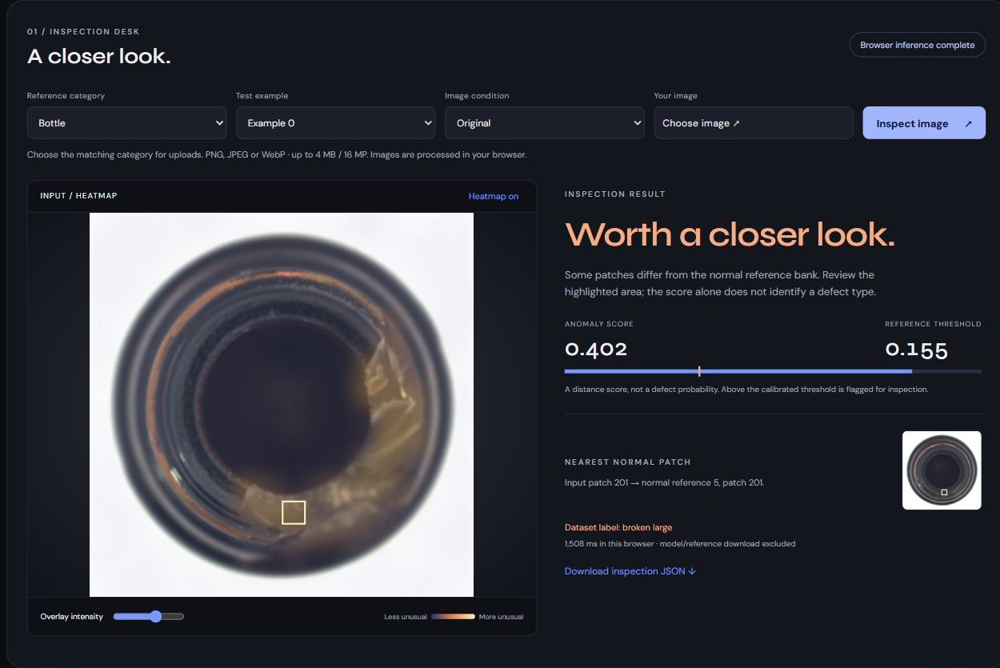

# InspectLab

Visual defect detection from normal reference images. Upload a bottle, metal nut or zipper image, inspect the heatmap, and compare the most unusual patch with its nearest normal reference.

[Try the browser app](https://charanvalavala.github.io/demos/inspectlab/) · [Full results](reports/results.json)



## Results

349 official MVTec AD test images across three categories. Each setting uses three reference-sampling seeds; results below average categories equally. The encoder is frozen, and every run uses the same quantized ONNX model as the demo.

| Normal references per category | RGB image AUROC | Transformer image AUROC | Transformer pixel AUROC |
|---|---:|---:|---:|
| 1 | 0.690 | 0.921 +/- 0.010 | 0.909 |
| 4 | 0.771 | 0.983 +/- 0.002 | 0.936 |
| 16 | 0.841 | 0.988 +/- 0.002 | 0.945 |

Pixel AUROC is measured at 56 x 56. Image AUROC measures ranking, not accuracy at the inspection threshold. These are selected categories, not the full MVTec benchmark.

## Run

Python 3.12+, from the repository root. The commands work in bash and PowerShell.

```text
python -m venv .venv
```

Activate with `source .venv/bin/activate` on macOS/Linux or `.venv\Scripts\Activate.ps1` in PowerShell.

```text
python -m pip install -r requirements.txt
python -m uvicorn inspectlab.api:app --port 8000
```

Open http://127.0.0.1:8000. The checked-in encoder and reference banks are sufficient for inference. The browser downloads about 25 MB for the encoder and 6 MB per selected reference category, then runs locally. It needs the pinned ONNX Runtime CDN on first load; images are not sent to a server. A separate local JSON API is available at `/docs`.

## Reproduce

```text
python scripts/download.py
python scripts/export.py
python scripts/evaluate.py
python scripts/stage.py
python -m pytest -q
```

The three dataset archives total about 481 MB. Downloads stay in `.cache/`; measured archive hashes and the model revision are recorded in `reports/downloads.json`. `requirements-lock.txt` records the tested packages. Full reproduction also needs the export dependencies in `requirements.txt`.

## Method

Resize to 224 x 224, extract 256 DINOv2 patch vectors, and compare each with the normal reference bank using cosine distance. Average the largest 1% of distances for the image score. Upsample patch distances to display the anomaly map.

Every fifth sorted normal training image is reserved for calibration and excluded from reference sampling. The threshold is its 95th-percentile image score. Test labels are used only for evaluation. Reference IDs and splits are saved in `reports/splits.json`.

## What fails

Zippers are harder with one reference: image AUROC ranges from 0.739 to 0.809 across seeds. At the demo's clean threshold, zipper inspection misses 10/119 defects and flags 6/32 normal images. Blur and JPEG compression can flag nearly every normal image. Changing lighting, camera or product type needs new validation and threshold calibration; a high AUROC does not fix that.

The heatmap shows feature differences, not a diagnosis or proof of why a defect occurred. The encoder is pretrained; this project does not train a transformer from scratch. Arbitrary uploads outside the three reference categories are unsupported.

## Data and model

Method inspiration: [AnomalyDINO](https://github.com/OJ2001/AnomalyDino). The application, scoring, evaluation and browser workflow are implemented here.

Pretrained [DINOv2-small](https://huggingface.co/facebook/dinov2-small): Apache-2.0. [MVTec AD](https://www.mvtec.com/research-teaching/datasets/mvtec-ad): CC BY-NC-SA 4.0, for non-commercial use. The demo includes resized examples; original data and attribution are listed in [NOTICES](NOTICES.md). Application code: MIT.
